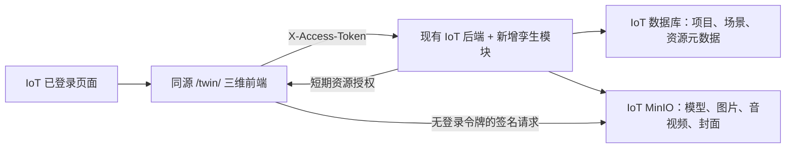

# `iot-3d` 接入约定

更新于 2026-10-20。本分支从 `main` 的 `61c71a1` 创建，按用户要求命名为 `iot-3d`。这里只实现 DTwin 前端改造，不运行独立 DTwin 后端，不升级 IoT 的 Umi 2 / React 16 / Node 16 或 Java 8 / Spring Boot 2.3.7 / WebFlux 技术栈。

**状态：前端适配与隔离测试已完成；下文 `/twin/*` 业务接口、孪生权限及数据存储是待 IoT 后端实现的契约，不是现有可用接口。** IoT 现有 `/authorize/me` 和登录令牌格式已从代码核对。没有权限时前端显示未授权，没有业务接口时明确提示尚未接入。

## 1. 运行与部署



两套前端独立安装依赖、构建和发布。同域下用独立页面或 iframe 承载三维工作区，IoT 不引入 DTwin 的 React/Three.js 依赖。当前改动只加了 IoT 本地 `/twin` 代理，尚未新增正式 IoT 菜单。

本地分别启动：

1. IoT 前后端使用原启动命令；前端通常 8000，后端 18848。
2. DTwin 使用 Node 24.0.2 / pnpm 10.0.0，执行 `pnpm install --frozen-lockfile`、`pnpm dev:web`，监听 `127.0.0.1:5173`。
3. 在 IoT 登录后打开其同源 `/twin/`，例如 `http://localhost:8000/twin/`。主机名必须与登录时相同，`localhost` 和 `127.0.0.1` 不共享存储。

IoT 开发代理将 `/twin` 原样传给 5173（包含 Vite HMR WebSocket），已有 `/cloud` 继续转发到 IoT API。直接打开 5173 不会获得 8000 的登录态。不要把令牌加入 URL 或复制到环境文件绕过这一边界。

构建产物为 `apps/web/dist`，Vite 基路径固定为 `/twin/`。例如将其内容部署到 `/srv/iot-site/twin/`，在现有同源 Nginx 虚拟主机中增加：

```nginx
location = /twin {
    return 302 /twin/;
}
location ^~ /twin/ {
    root /srv/iot-site;
    index index.html;
    try_files $uri $uri/ =404;
}
```

三维路由使用 hash，无需把不存在的模型/脚本返回为 HTML。保留 IoT 现有 API 代理；新增实时通道需要该代理支持 WebSocket 升级。`index.html` 不应长期缓存，更新时应保留仍在使用的版本资源。以上仅是部署示例，本轮未执行服务器发布。

环境字段见 [`apps/web/.env.example`](../apps/web/.env.example)：

| 配置 | 当前默认/用途 |
| --- | --- |
| `VITE_IOT_API_PREFIX` | 开发 `/cloud`，生产 `/cloudPro/api`，仅接受同源路径 |
| `VITE_IOT_HOME_PATH` | `/`，返回 IoT |
| `VITE_IOT_LOGIN_PATH` | `/user/login`，由 IoT 处理登录 |
| `VITE_IOT_RESOURCE_ORIGINS` | 逗号分隔的 MinIO 浏览器访问 origin；默认仅允许同源 |
| `IOT_DEV_API_TARGET` | Vite 开发代理目标，默认 `http://127.0.0.1:18848`，不进入浏览器包 |

## 2. 身份与权限

- 只读取 IoT 的 localStorage `x-access-token`，请求头为 `X-Access-Token`。
- 使用 `GET {API}/authorize/me` 的 `result.user.id/name` 与 `result.permissions[].id/actions[]` 验证身份和能力。
- 前端不使用旧平台管理员角色、用户名 `admin` 或 `hsweb-autz` 缓存绕过权限，不提供创建用户、独立登录或独立退出。
- 无会话引导至 IoT；401 清除本工作区显示但不修改 IoT 自己的存储；403 明确拒绝。
- 聚焦、恢复可见、跨窗口会话变化时重新校验。同一身份后台校验不丢草稿；校验失败时保留草稿并禁用交互，重试成功后恢复。账号或模块权限改变会重新建立工作区，旧请求响应不能进入新账号界面。
- IoT 后端必须独立验证每次调用的用户、项目和资源范围，前端的菜单隐藏不是授权边界。

拟新增 IoT 权限：

| 权限/动作 | 当前前端用途 |
| --- | --- |
| `twin-project:query` | 进入 3D / 2D 项目、模板与授权运行页面 |
| `twin-project:save` | 在有 query 权限的前提下创建项目 |
| `twin-resource:query` | 在有项目权限的前提下进入静态资源管理 |

权限尚需在 IoT 注册并分配，现有 IoT 管理员不会被前端自动授予。项目响应仍需提供 `projectRole: owner/editor/viewer/null`，场景/画布响应提供 `editable`。它们由 IoT 用户与数据权限计算，不新建 DTwin 用户或密码库。后端还需校验修改、删除、上传、发布的细粒度权限；如果 IoT 权限模型不能直接表达项目角色，应调整适配契约，不能放宽为“登录即可编辑”。

`#/users` 与 `#/share/*` 已停用。保留的项目版本运行页面仍要求 IoT 会话和项目权限，不允许匿名访问。

## 3. 统一传输与业务接口

`apps/web/src/api.ts` 是唯一业务传输入口。编辑器沿用逻辑 `/api/v1/*` 路径，传输时统一映射：

| 逻辑地址 | 开发浏览器地址 | 生产浏览器地址 |
| --- | --- | --- |
| `/api/v1/projects` | `/cloud/twin/projects` | `/cloudPro/api/twin/projects` |
| `/api/v1/projects/{id}/scene` | `/cloud/twin/projects/{id}/scene` | `/cloudPro/api/twin/projects/{id}/scene` |

若网关移除 `/cloud` 或 `/cloudPro/api`，IoT 控制器实际接收 `/twin/*`。这不要求保留独立 DTwin 服务的 `/api/v1` 路由。

成功 JSON 使用 IoT 包装：

```json
{
  "status": 200,
  "result": { "projects": [] },
  "requestId": "request-id"
}
```

`result` 内保留现有业务 DTO，不对任意返回值做静默兼容。错误建议为 `{status:403,code:"forbidden",requestId:"..."}`，同时使用正确 HTTP 状态码。HTTP 200 中的业务错误仍会被拒绝。确实无内容的 204/205 可返回空体。

普通 404 表示接口未接入；真实业务缺失应返回明确 `code`（例如 `project_not_found`、`model_asset_not_found`），便于与缺少控制器区分。诊断记录方法、无查询串的路径、状态和请求标识，不记录令牌、请求体、签名 URL 或原始服务端错误正文。

IoT 后端最小闭环优先实现以下接口；前缀均为 `/twin`：

| 接口族 | 用途 / 数据约定 |
| --- | --- |
| `GET/POST /projects` | 返回 `{projects}` / `{project}`；创建体 `{name,projectType:"3d"或"2d"}` |
| `PATCH/DELETE /projects/{id}` | 改名/删除；检查 IoT 数据权限及资源引用 |
| `GET/PATCH /projects/{id}/scene` | 场景、`editable`、预算、`expectedRevision`、实例增量和扩展字段 |
| `GET/PATCH /projects/{id}/canvas` | 2D 画布与详情层，沿用版本检查和节点增量 |
| `/projects/{id}/model-assets` | 列表、上传、单个删除；GLB/自包含 glTF 元数据与模型检查结果 |
| `/projects/{id}/image-assets`、`media-assets` | 图片、音视频的列表、上传、删除及引用统计 |
| `PUT /projects/{id}/cover` | PNG 封面，查询参数 `sourceRevision` / `expectedCoverRevision`，并发保护 |
| `GET /projects/{id}/…/content/access` | 单个私有资源临时下载授权 |
| `GET /projects/{id}/cover.png/access?revision=N` | 当前封面版本的临时下载授权 |

项目卡片需要 `id/name/projectType/status/projectRole/createdAt/updatedAt` 及封面状态、版本和逻辑访问路径。完整字段见 [`App.tsx`](../apps/web/src/App.tsx) 与 [`ProjectCoverQueue.tsx`](../apps/web/src/covers/ProjectCoverQueue.tsx)。封面 URL 继续使用项目逻辑路径，不能在项目列表持久保存临时签名。

模型/图片/音视频上传采用 **原始文件请求体**，`POST {collection}?filename=...`，声明文件 `Content-Type`，不使用 multipart。服务端必须校验真实格式、体积和项目权限；返回 `modelAsset` / `imageAsset` / `mediaAsset`。元数据 DTO 与引用统计分别见 [`model-assets.ts`](../apps/web/src/canvas/model-assets.ts)、[`image-assets.ts`](../apps/web/src/canvas/image-assets.ts)、[`media-assets.ts`](../apps/web/src/canvas/media-assets.ts)。

场景契约见 [`shared/standalone-3d.ts`](../shared/standalone-3d.ts) 和 [`Standalone3DProjectPage.tsx`](../apps/web/src/pages/Standalone3DProjectPage.tsx)。IoT 可采用自己的数据库结构，但必须持久化版本、实例、资源引用和扩展，不能用空文档或默认值掩盖未支持字段。沿用原前端有界预算，不自动扩大模型规模。

后续接口还包括资产台账、数据源/指标映射、运行数据、发布版本与快照资源、`twin-drive` 配置/检查/采集。相关定义在 `apps/web/src/canvas/assets.ts`、`data-sources.ts`、`publications.tsx` 和 `shared/twin-drive.ts`。目前这些请求同样指向 IoT，但并未因此完成对应服务端能力。

## 4. MinIO 访问链

项目、资源归属、文件检查结果和引用关系由 IoT 数据库保存，文件内容由 IoT MinIO 保存。资源上传先经过 IoT 鉴权和格式检查，浏览器不持有 MinIO Access Key / Secret Key，也不把桶设置为公开。

`GET …/content/access`、封面 access 或发布快照资源 access 在检查用户、项目及资源归属后返回：

```json
{
  "status": 200,
  "result": {
    "url": "https://files.example.com/private/object?X-Amz-Signature=...",
    "expiresAt": 1792454400000
  }
}
```

上述时间只是结构示例。`expiresAt` 必须为当前时间后 **超过 30 秒、最多 5 分钟** 的 Unix 毫秒；建议签发 120 秒。URL 只能使用允许的 origin，不得包含 IoT 登录令牌或永久凭据；HTTPS 页面拒绝 HTTP 文件地址。需要更快撤销的场景应采用每次校验的同源文件代理，已经签发的 MinIO 链接在到期前仍可能使用。

模型、图片、音视频、项目封面以及发布快照资源统一经 `src/iot/resources.ts` 授权后加载。授权缓存有界、按当前会话隔离；显式重试重新获取签名。二进制下载不发送 IoT Token/Cookie，取消场景后中止请求，账号变化后丢弃旧下载结果。临时链接过期或下载失败会显示错误，不能回退到匿名桶或返回空模型。

跨域 MinIO 应设置允许 IoT 站点的 CORS，支持模型 GET、封面截图读取以及音视频所需 Range 请求；浏览器可访问的 HTTPS 地址应与签名 host 一致，代理不得破坏签名。长视频在签名过期后发起新的 Range 请求可能失败，当前支持显式重载；需连续长播放时应另实现受权限保护的媒体代理，不能延长成永久 URL。

内置示例模型和图片是白名单内的公开静态文件，仍从 `/twin/` 加载。用户文件不能伪装为内置文件。

## 5. 实时数据与产线接入

现有三维运行时保留插值、状态颜色、房间报警、设备详情和 2D 联动。**这些能力尚未连接真实 IoT 设备。** 当前三维场景的资产/指标关联仍沿用已有的关联 2D 项目模式；后续需设计 IoT 设备 ID 与资产 ID 映射、设备属性与单位、状态枚举、采样时间、陈旧阈值、报警事件及详情入口，不能把“已登录 IoT”当作“已完成设备绑定”。

浏览器实时连接需要新增：

1. `POST /twin/projects/{projectId}/twin-drive/stream-ticket`：携带 IoT 请求头，返回 `{ticket,expiresAt}`；票据为 24–512 个 base64url 字符，寿命最多 60 秒。
2. `WS /twin/twin-drive?projectId=...&ticket=...`：IoT 原子消费单次票据，验证身份/项目/过期时间；HTTPS 页面使用 WSS。
3. 后续传输 `shared/twin-drive.ts` 定义的真实观测数据与采样时间；权限撤销或会话失效时服务端终止连接。

登录令牌不进入 WS URL，网关日志也应过滤短期票据。每次重连获取新票据，关闭场景时取消尚未完成的票据请求。现有传输重连次数有上限，授权失败明确显示错误。前端不绕过 IoT 直连 PLC/MQTT/工业设备，也不在失败时制造模拟实时值。

原独立后端测试业务模板、示例地址填写按钮、AI 场景底座、BIM/CAD 转换、写实重建与模型压缩入口已撤下，不将它们纳入此次最小 IoT 接入闭环。保留的普通车间模板明确属于示例布局和预设动画。

## 6. 验证和下一步

本轮已验证前端构建、IoT 传输与权限单元测试、场景运行时/实时驱动、封面等待与错误处理，以及隔离浏览器页面。浏览器测试检查匿名零业务请求、默认 3D、无用户管理、封面临时授权、草稿保留、缺失接口、权限回收、过期会话与 `/twin/` 静态文件。

浏览器脚本自建临时 Vite 服务和接口数据，运行 `pnpm test:iot-integration:browser`；已有 Playwright 环境可通过 `PLAYWRIGHT_MODULE_PATH` 指定模块绝对路径，`CHROMIUM_EXECUTABLE` 指定浏览器。不会登录或写入真实 IoT。

IoT 后端实施后必须另做真实联调：

1. 注册孪生权限，以允许/拒绝两个账号检查模块、项目和资源隔离。
2. 创建产线项目 → 上传真实 GLB 到 IoT MinIO → 搭建并保存场景 → 刷新重开，验证持久化、版本冲突与封面。
3. 删除引用中资源被明确拒绝；过期签名、网络异常、账号切换不能泄漏资源或伪装成功。
4. 接入一台 IoT 设备，核对状态、属性、采样时间、断线/陈旧、报警产生/恢复及详情。
5. 验证 WS 票据只能使用一次、不能跨项目，并在多个产线和只读账号下回归发布/预览。

以上真实联调尚未执行，原独立后端及其数据未修改，也未提交、推送或部署本轮改动。
